<div align="center">


# Trackio

### One number between you and your bag — fused GPS + radio tracking with instant lost-bag alerts.

**Drift warnings at 30 m. A full-screen alarm at 80 m. Panic packets at 1 Hz. A guided recovery that only ends when you're holding the bag again.**

[](https://flutter.dev)
[](https://dart.dev)
[](#quick-start)
[](#languages)
[](CONTRIBUTING.md)
[](LICENSE)
[](docs/DEMO_GUIDE.md)

**[Demo guide](docs/DEMO_GUIDE.md) · [Architecture](docs/ARCHITECTURE.md) · [Product spec](docs/PRD.md) · [Gallery](docs/screenshots)**

[Quick start](#quick-start) · [How Trackio works](#how-trackio-works) · [The lost-bag flow](#the-lost-bag-flow) · [What's real vs simulated](#whats-real-vs-simulated) · [Screenshots](#screenshots) · [FAQ](#faq) · [Documentation](#documentation)

<code>flutter run -d chrome</code>

<br />

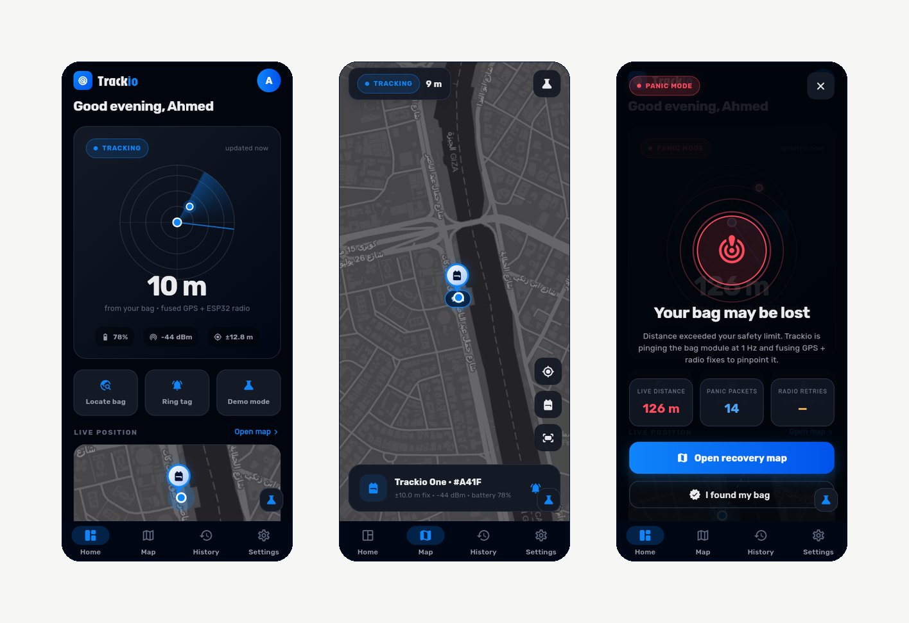

<br /><br />

</div>

---

Bags get lost in ordinary ways — left at a café table, pulled from a carousel
by mistake, set down for thirty seconds and forgotten. Existing trackers tell
you where the bag *was*, hours later. Trackio answers a different question,
continuously: **how far is my bag from me right now, and is something wrong?**

The phone fuses three signals — its own GPS, the bag module's GPS, and the
short-range ESP32 radio link — into one distance estimate. When that distance
behaves abnormally, the app escalates on its own: a warning banner, then a
full-screen alarm, then panic mode, where the bag module reports at 1 Hz for
as long as battery allows. The alert never expires on its own; only
**"I found my bag"** ends it.

> The tracking pipeline now runs on a **real BLE link** to the ESP32
> follow-car/bag-module firmware: scan, secure pairing (passkey `246810`),
> live RSSI/telemetry, reconnect and the full loss state machine. The
> deterministic simulation remains available as an explicit offline/QA
> mode behind the same `TrackingEngine` interface. See
> [BLE integration](docs/BLE_INTEGRATION.md) and
> [What's real vs simulated](#whats-real-vs-simulated).

## How Trackio works

One phone, one bag module, one self-hosted cloud — and a radio link that is
the source of truth for everything live.

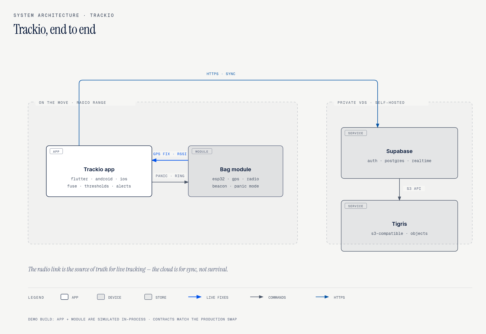

<br /><br />

The fused distance is computed on every recheck tick from three noisy inputs.
Thresholds turn that number into behaviour — no feeds, no dashboards, no
noise:

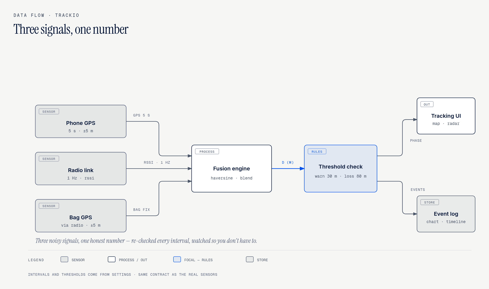

## The lost-bag flow

The tracking engine is a five-state machine with configurable thresholds.
It watches so you don't have to — and it never forgets a bag:

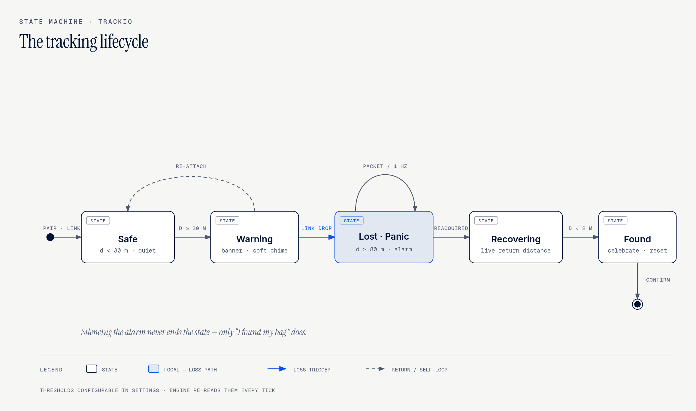

| Phase | Trigger | What you see |
|---|---|---|
| **Safe** | distance < 30 m, link healthy | Quiet dashboard: distance, radar, battery, RSSI |
| **Warning** | distance ≥ 30 m | Non-intrusive banner + soft chime; self-dismisses on re-attach |
| **Lost · Panic** | distance ≥ 80 m **or** radio link drop | Full-screen alert + chosen alarm; bag reports at 1 Hz; packet counter climbs; map pins last-known position with pulsing rings |
| **Recovering** | link re-detected | Live shrinking distance, return route on the map |
| **Found** | distance < 2 m + your confirmation | Celebration, panic mode off, event logged |

Silencing the alarm never ends the state. Battery drain during panic mode is
modelled and shown on the bag card.

## Quick start

```bash
git clone git@github.com:abdou-da0wew/Trackio.git
cd Trackio
flutter pub get
flutter run -d chrome     # web demo — fastest, no phone needed
flutter run               # or pick an Android / iOS device
```

No API keys. No accounts. The map tiles are keyless. After sign-in the app
opens the **connect screen**: power on an ESP32 module running the
[follow-car firmware](docs/BLE_INTEGRATION.md), scan, pair with passkey
`246810`, and live RSSI telemetry drives the dashboard. *Explore without
hardware* falls back to the deterministic simulation engine.

### Stage shortcuts (deep links)

| URL fragment | Stage |
|---|---|
| `?shot=home&state=tracking` | Dashboard, live tracking |
| `?shot=home&state=warning` | Distance-warning state |
| `?shot=home&state=alert` | Panic overlay + alarm |
| `?shot=map&state=alert` | Recovery map in panic mode |
| `?shot=home&state=found` | Recovered state |
| `?shot=splash/onboarding/login/otp` | Entry screens |
| `?panel=1` | Auto-open the demo control panel |
| `?theme=light` / `?theme=dark` | Force a theme |

The **🧪 demo lab** (bottom-right in-app) opens manual controls — drift the
bag, cut the radio link, send panic packets, recover, reset — plus the
scripted loss-and-recovery scenario with 1×/4×/8× speed. The full
five-minute presentation script lives in the
[demo guide](docs/DEMO_GUIDE.md).

## What's real vs simulated

Honest about the seams — that's what makes the demo trustworthy:

| Component | In this build | In production |
|---|---|---|
| Every screen & interaction | ✅ real, working code | same |
| BLE transport: scan, secure pair/bond, GATT notify/write, reconnect | ✅ real (`flutter_blue_plus`, Android/iOS/web) | same |
| RSSI filtering + path-loss distance | ✅ real, Dart port of the firmware DSP, fed by the module's 2 Hz telemetry | same |
| Tracking phase machine, thresholds, panic/loss flow | ✅ real logic on real link events (RSSI, disconnect, reconnect) | same |
| Relative radar (distance + radar-sweep bearing) | ✅ real telemetry, polar view (module has no GPS) | add GPS module for geographic map |
| Map (simulation mode) | ✅ real keyless Esri canvas tiles (dark/light) | self-hosted tiles or Google Maps — one URL string |
| Alarm sounds, themes, settings persistence | ✅ real | same |
| Offline simulation engine | ✅ deterministic Cairo-walk source behind the same interface | QA / demos only |
| Auth (signup → OTP → session) | 🔶 mock service, identical contract | `supabase_flutter` drop-in |
| Cloud sync (Supabase + Tigris on VDS) | 🔶 represented in UI | self-hosted stack per the [PRD](docs/PRD.md) |

## Languages

**English and Arabic, end to end.** Localization follows Flutter's official
`gen_l10n` pipeline (`l10n.yaml` + `.arb` bundles in [`lib/l10n/`](lib/l10n)):

- **Language detection** — the platform/browser locale list resolves against
  the supported locales (`en`, `ar`), exactly as documented in the Flutter
  internationalization guide.
- **In-app switch** — *Settings → Language* offers **System / English /
  العربية**; the choice persists and overrides the system instantly.
- **Full RTL** — the whole layout mirrors automatically for Arabic, including
  navigation, cards, charts and the map chrome.
- **Typeface plan** — Rubik for English, Zain for Arabic (applied
  automatically when the resolved locale is `ar`), Jaro reserved for the
  logo. All three are **bundled as assets**, so nothing is fetched from the
  network at runtime — the demo renders identically offline.
- **Even the simulation speaks** — engine events and demo captions are
  locale-free codes resolved to localized text in the UI layer
  (`lib/core/l10n_text.dart`), so the event log and movie-mode captions are
  fully translated.

## Screenshots

| | | |
|---|---|---|
| 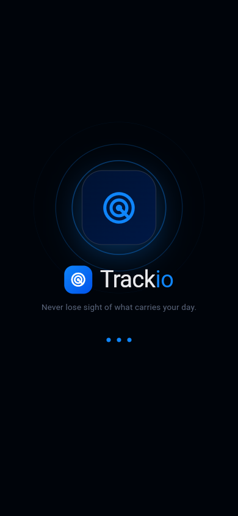 | 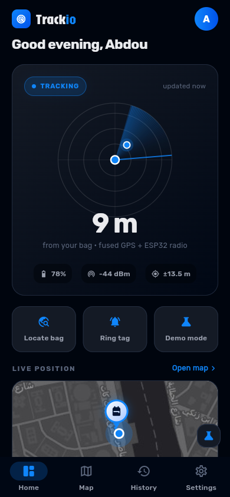 | 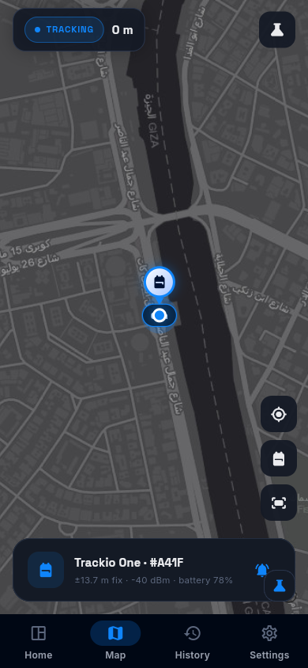 |
| *Splash & radar identity* | *Dashboard — safe, 8 m* | *Live map with connector & distance* |
| 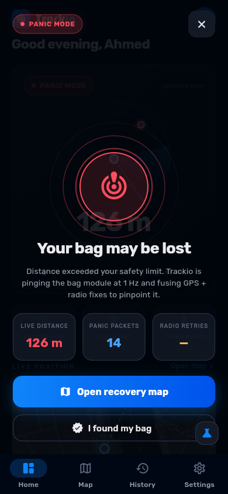 | 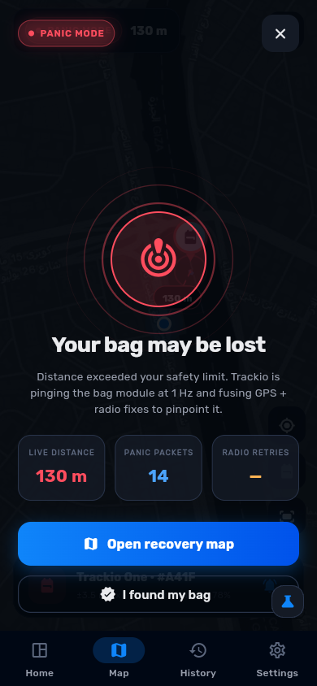 | 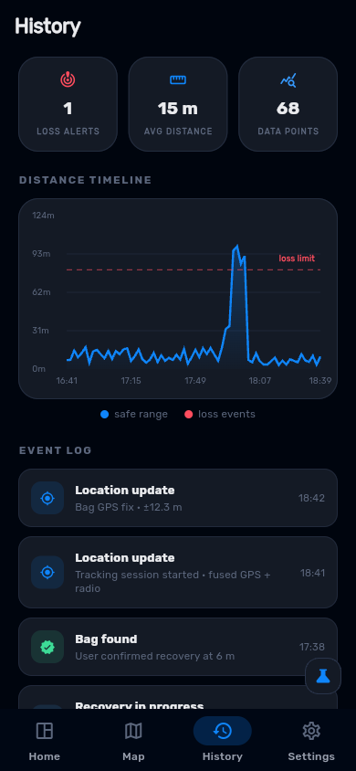 |
| *Lost-bag alert + panic mode* | *Panic pulses on last-known pin* | *Distance timeline & event log* |
| 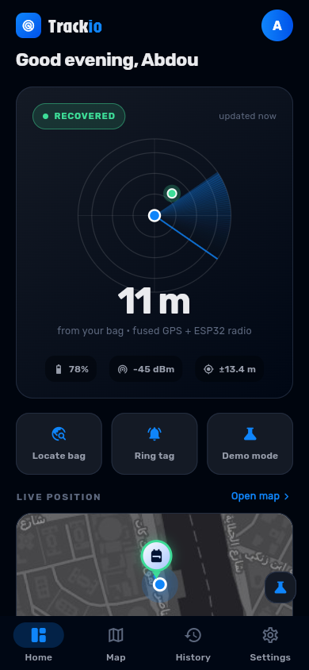 | 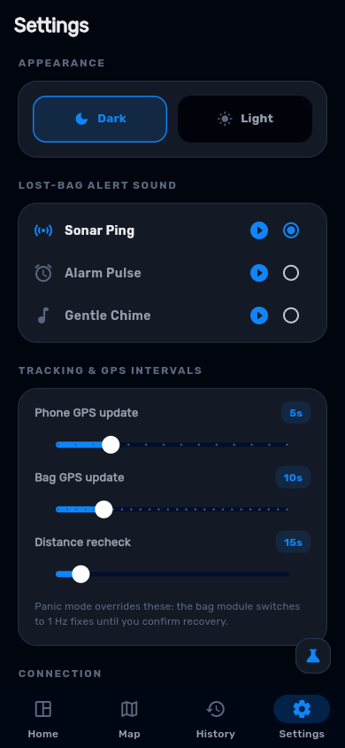 | 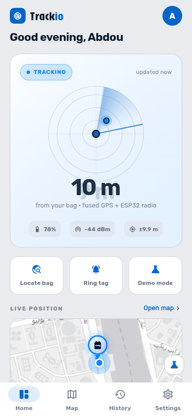 |
| *Recovered & confirmed* | *Language, sounds, intervals* | *Light theme* |
| 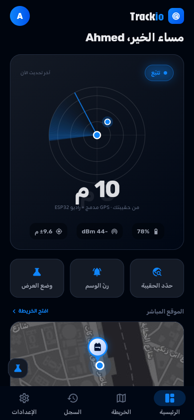 | | |
| *Arabic UI — full RTL, Zain typeface* | | |

Full gallery (16 shots, both themes + Arabic RTL): [`docs/screenshots/`](docs/screenshots).

## FAQ

<details>
<summary><strong>Is this live GPS?</strong></summary>

Not yet. This build simulates the fused phone-GPS / bag-GPS / radio pipeline
deterministically — that's what makes demos repeatable and screenshots
staged-able. The phase machine, thresholds, alert flow and every screen are
production-intent. The swap plan is a table in
[docs/ARCHITECTURE.md](docs/ARCHITECTURE.md).

</details>

<details>
<summary><strong>What happens if I kill the app?</strong></summary>

In this build, tracking restores automatically when the app relaunches
(FR-T5 in the [PRD](docs/PRD.md)). In production, a foreground service keeps
the watch alive and the OS notification channel raises the alarm — that's
milestone M3.

</details>

<details>
<summary><strong>Why does the alarm keep ringing until I confirm?</strong></summary>

Because "silence" is not "found". The state machine only leaves
<em>Lost · Panic</em> through <strong>"I found my bag"</strong> — the same
rule the real product will follow. The demo enforces it so stakeholders feel
the design decision.

</details>

<details>
<summary><strong>Why panic packets at 1 Hz?</strong></summary>

It's the highest sustainable cadence for the module's battery budget, with
accuracy tightening to ±3 m — enough to guide a human to a bag in a crowded
place. Every packet carries battery level; the module also caches its last
fix during link drops (store-and-forward).

</details>

<details>
<summary><strong>Which map provider does it use?</strong></summary>

Keyless Esri canvas tiles styled to the theme — no API key, no watermark.
OpenStreetMap-class or Google Maps are one <code>urlTemplate</code> change;
the PRD leaves the production choice open.

</details>

<details>
<summary><strong>Does the demo need the backend running?</strong></summary>

No. Auth is an in-memory mock with persisted session, history is generated
locally, and nothing network-critical leaves the device. The cloud in the
architecture diagram is the production story, not a demo dependency.

</details>

<details>
<summary><strong>I hit a bug</strong></summary>

Open an [issue](https://github.com/abdou-da0wew/Trackio/issues) with the
deep link that reproduces it (e.g. <code>?shot=home&state=alert&panel=1</code>)
— the stage shortcuts make most states reproducible in one URL.

</details>

## Documentation

| Doc | Contents |
|---|---|
| [`docs/BLE_INTEGRATION.md`](docs/BLE_INTEGRATION.md) | Live GATT link: UUIDs, pairing, telemetry frame, RSSI math, loss rules, platform notes |
| [`docs/PRD.md`](docs/PRD.md) | Full product requirements: features, bag module (ESP32), backend, complete colour-spec tables, roadmap |
| [`docs/ARCHITECTURE.md`](docs/ARCHITECTURE.md) | Layers, BLE + simulation engines, data model, ESP32 packet protocol, mock→production swap table |
| [`docs/DEMO_GUIDE.md`](docs/DEMO_GUIDE.md) | 5-minute stakeholder script, manual controls, deep links, FAQ |
| [`CONTRIBUTING.md`](CONTRIBUTING.md) | Ground rules (palette tokens, service boundaries), commit style |
| [`CHANGELOG.md`](CHANGELOG.md) | Release notes |
| [`SECURITY.md`](SECURITY.md) | Responsible disclosure |

## Contributing

We'd love your help — real platform channels for GPS/radio, `supabase_flutter`
wiring, ESP32 firmware, localisation, widget tests. Open an
[issue](https://github.com/abdou-da0wew/Trackio/issues) or a
[pull request](https://github.com/abdou-da0wew/Trackio/pulls);
[CONTRIBUTING.md](CONTRIBUTING.md) has the ground rules. Every change is gated
by `flutter analyze` and `flutter test` — the palette-lock test means no
hardcoded colours survive review.

## Disclaimer

Trackio's demo build simulates tracking for presentation purposes and is not
a safety device. The production product's accuracy depends on hardware,
radio conditions and platform constraints; keep an eye on your bag regardless.

## License

[MIT](LICENSE) — alarm sounds and artwork are generated originals for this
project.
